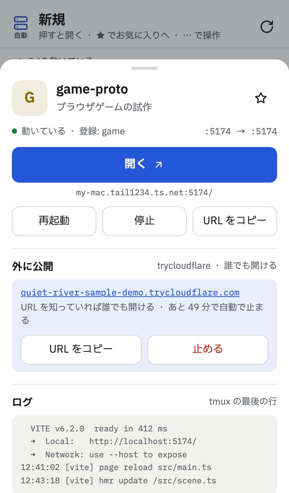

# simple-localserver-list

Tailscale で立てたサーバーを管理するパネルと、AI にサーバーを登録させるためのスキル。

AI に開発サーバーを立ててもらい、スマホで動作を確かめる。そんな使い方のためのものです。
このパネルをスマホのホーム画面に追加しておけば、確かめたいサーバーをタップするだけで開けます。
サーバーが落ちていたら立て直す、友達に見せたくなったら trycloudflare で外に公開する、といったことも数タップでできます。

<p align="center">
  
  
  
</p>

## できること

- AI が立てたサーバーが、新しい順に一覧に並ぶ。よく使うものは ★ でホーム画面のように並べられる
- 止まっているサーバーをタップすると、立て直してから開く(起動のしかたを覚えているので、Mac を再起動したあとでも)
- 落ちたサーバーは赤く表示され、ログの最後をその場で読める
- 「外に公開」を押すと、誰でも開ける trycloudflare の URL ができる。1 時間で自動で止まる
- 使わなくなったサーバーや、止まったまま残っている `tailscale serve` の設定を、画面から消せる

## 始め方

要るもの: Mac、Python 3.10 以上、tmux、[Tailscale](https://tailscale.com)(tailnet で HTTPS を有効にしておく)。
外に公開する機能を使うときは [cloudflared](https://developers.cloudflare.com/cloudflare-one/connections/connect-apps/install-and-setup/installation/) も要ります。

1. 取ってきて、`srv` に PATH を通す

   ```sh
   git clone https://github.com/Kamesuta/simple-localserver-list.git
   ln -s "$PWD/simple-localserver-list/srv" ~/.local/bin/srv
   ```

2. パネルを立てる。出た URL をスマホで開き、ホーム画面に追加する

   ```sh
   srv ui
   # https://<Mac の名前>.<tailnet>.ts.net:7463/
   ```

3. Claude Code にスキルを入れる

   ```sh
   ln -s "$PWD/simple-localserver-list/skill" ~/.claude/skills/srv
   ```

   スキルだけだと読まれないことがあるので、`~/.claude/CLAUDE.md` にも一言書いておくと確実です。

   ```md
   人に見せるサーバーは srv add で立てる(使い方はスキル srv)。
   ```

これで、AI がサーバーを立てるたびにパネルに並ぶようになります。
すでに動いているサーバーは、パネルの「片付け」から登録できます。

Mac にログインしたときにパネルも立てる方法、設定、仕組みは [docs/details.md](docs/details.md) にあります。

## 注意

- パネルとサーバーは tailnet の中にだけ出ます。tailnet に入っている端末からは、登録されたサーバーの起動・停止・削除と、外への公開ができます。人と共有している tailnet なら、ACL で自分の端末に絞ってください
- 「外に公開」した URL は、知っていれば誰でも開けます。ファイルを消せる画面などは出さないでください

## ライセンス

[MIT](LICENSE)
