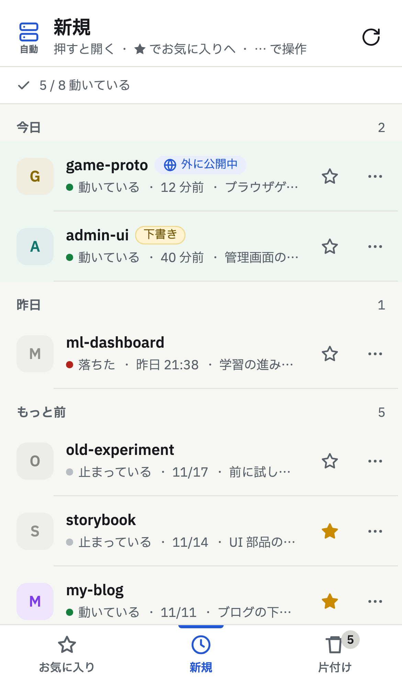
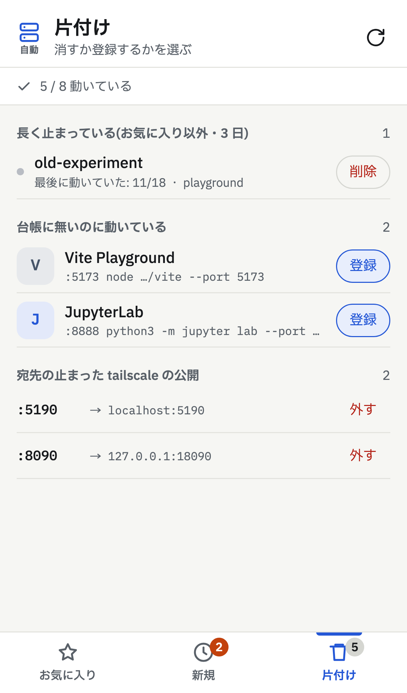
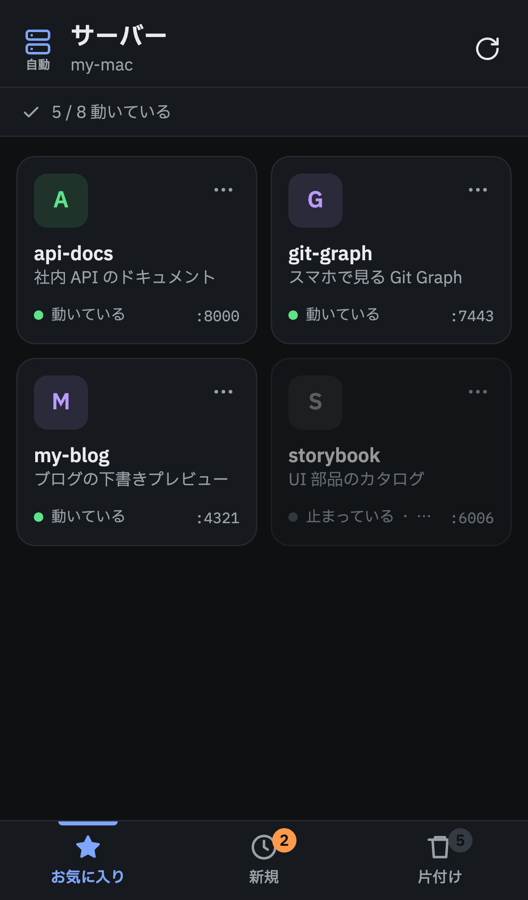
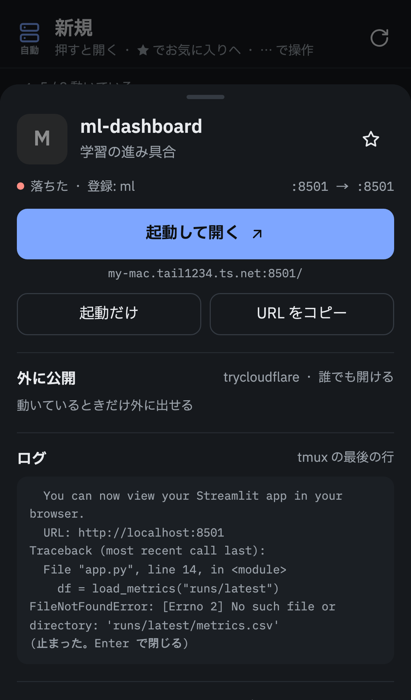

# simple-localserver-list

**立てたサーバーを見失わない台帳とランチャー。** Mac で立てた開発サーバーを「起動のしかた」ごと台帳に登録し、Tailscale 越しにスマホのホーム画面から一覧・起動・停止できる。
AI エージェントにあちこちでサーバーを立てさせても、リンクが散らばらない。Mac を再起動しても、ボタン 1 つで元に戻せる。

<p align="center">
  
  
  
</p>

## ✨ ウリ

- **📒 起動のしかたごと台帳に** ― `srv add` 1 回で、tmux で起動し、返事を待って `tailscale serve` で出し、URL まで出す。フォルダ・コマンド・環境変数が残るので、止まっても同じ形で立ち上げ直せる
- **📱 押せば飛ぶランチャー** ― ★ を付けたものはホーム画面のようにタイルで並ぶ。止まっていれば起動してから飛ぶ。各ページの favicon と `<title>` を拾って並べる
- **🆕 新しく立ったものが分かる** ― 新規のタブに、登録の新しい順で並ぶ。前に見たあとで増えたものには色が付き、タブに件数が出る
- **🧹 片付けがまとまっている** ― 長く止まっているもの、台帳に無いのに動いているもの(1 タップで下書き登録)、宛先の止まった `tailscale serve` の公開を、1 つのタブで消すか登録するか選べる
- **🌐 1 タップで外に公開** ― [trycloudflare](https://try.cloudflare.com) の使い捨て URL を作る。1 時間で自動で止まり、止めれば URL ごと使えなくなる
- **🔴 落ちたらすぐ分かる** ― コマンドが終わったら 🔴 にし、tmux のログの最後をシートに出す
- **🤖 AI エージェント向けのスキル付き** ― Claude Code に [`skill/SKILL.md`](skill/SKILL.md) を読ませれば、サーバーを `srv add` で立てるようになる
- **🪶 依存ゼロ** ― Python の標準ライブラリと素の HTML/JS だけ。ビルドも `npm install` も venv も要らない

<p align="center">
  
  
  
</p>

## 🚀 使い方

要るもの:
- Python 3.10 以上・tmux・lsof
- [Tailscale](https://tailscale.com)(tailnet で HTTPS を有効にしておく)
- 外に公開したいときだけ [cloudflared](https://developers.cloudflare.com/cloudflare-one/connections/connect-apps/install-and-setup/installation/) と dig

Mac で使っている。

```sh
git clone https://github.com/Kamesuta/simple-localserver-list.git
ln -s "$PWD/simple-localserver-list/srv" ~/.local/bin/srv     # PATH の通った場所に
srv ui                       # 一覧の画面を tmux で立て、tailnet にだけ出して URL を表示
```

出た URL(`https://<Mac の名前>.<tailnet>.ts.net:7463/`)をスマホで開き、ホーム画面に追加すればアプリのように開ける。

サーバーは `srv add` で立てる。

```sh
cd ~/src/my-blog
srv add blog-preview --port 4321 --note "ブログの下書きプレビュー" -- npx astro dev --port 4321
# → https://<Mac の名前>.<tailnet>.ts.net:4321/
```

| コマンド | すること |
| --- | --- |
| `srv add <名前> --port P [--note …] -- <コマンド>` | 台帳に書いて起動し、tailnet に出して URL を出す |
| `srv add … --no-start` | もう動いているものを、登録だけする |
| `srv start` / `stop` / `restart <名前>` | 起動・停止。停止すると公開も外れる(また起動すれば同じ URL) |
| `srv rm <名前>` | 止めて、公開を外して、台帳から消す |
| `srv ls` | 状態つきの一覧(🟢 動いている / 🟡 公開なし / ⏳ 起動中 / 🔴 落ちた / ⚪ 止まっている) |
| `srv logs` / `attach <名前>` | ログの最後を見る / tmux に入る |
| `srv fav <名前> [--off]` | お気に入り(画面の最初のタブ) |
| `srv share <名前> [--minutes 60] [--off]` | trycloudflare で外に公開する |
| `srv ui [stop\|attach]` | 一覧の画面を立てる / 畳む / ログを見る |
| `srv autostart` | `--autostart` を付けたものを全部立てる |
| `srv port` | 空いているポートを 1 つ出す |

`srv add` にはほかに、次の引数がある(`srv add -h`)。
- `--cwd`・`--env K=V`・`--env-file`(秘密はこちらに置き、台帳には場所だけ残す)
- `--path`(開くパス。起動の確認にも使う)
- `--https-port`(tailnet に出す番号。既定は `--port` と同じ)
- `--by`(誰が立てたか。新規のタブに出る)・`--fav`・`--autostart`

### ログイン時に立てる

LaunchAgent で `srv ui` と `srv autostart` を走らせる。`~/Library/LaunchAgents/local.srv.plist` の例:

```xml
<?xml version="1.0" encoding="UTF-8"?>
<!DOCTYPE plist PUBLIC "-//Apple//DTD PLIST 1.0//EN" "http://www.apple.com/DTDs/PropertyList-1.0.dtd">
<plist version="1.0"><dict>
  <key>Label</key><string>local.srv</string>
  <key>ProgramArguments</key><array>
    <string>/bin/zsh</string><string>-lc</string><string>srv ui &amp;&amp; srv autostart</string>
  </array>
  <key>RunAtLoad</key><true/>
</dict></plist>
```

```sh
launchctl load ~/Library/LaunchAgents/local.srv.plist
```

ログインした直後で、Tailscale がまだつながっていないときは、画面がつながるまで公開を張り直す。

### Claude Code に使わせる

```sh
ln -s "$PWD/simple-localserver-list/skill" ~/.claude/skills/srv
```

スキルだけだと読まれない場面があるので、`~/.claude/CLAUDE.md` にも一言書いておくと確実。

```md
## サーバーを立てるとき

人に見せるサーバーは `srv add <名前> --port P --note "何の画面か" -- <起動コマンド>` で立てる(使い方はスキル `srv`)。
素の `tailscale serve` や `&` で立てない。
```

> [!WARNING]
> 画面とサーバーは 127.0.0.1 だけで待ち、外へは `tailscale serve` で tailnet の中にだけ出す。
> tailnet の中の端末からは、台帳にあるサーバーの起動・停止・削除と、外への公開ができる。台帳のコマンドは書き換えられない(コマンドを書くのは `srv add` だけ)。
> 人と共有している tailnet なら、ACL で自分の端末だけに絞ること。
> 「外に公開」した URL は、知っていれば誰でも開ける。ファイルを消せる画面などは出さないこと。

## ⚙️ 設定

環境変数で変えられる。

| 変数 | 既定 | 意味 |
| --- | --- | --- |
| `SLL_HOME` | `~/.config/simple-localserver-list` | 台帳などの置き場所 |
| `SLL_PORT` / `SLL_HTTPS_PORT` | `7440` / `7463` | 画面が待つポート / tailnet に出す番号 |
| `SLL_RESERVED_PORTS` | `443` | 台帳からも画面からも触らない https の番号(カンマ区切り)。ほかの道具が使っている口を守る |
| `SLL_STALE_DAYS` | `3` | お気に入り以外で、これだけ止まっていたら片付けのタブに出す |

## 🧠 仕組み

- サーバーは tmux セッション `srv-<名前>` の中で動かす。落ちても `(止まった。Enter で閉じる)` で止まるのでログが残り、この印で「落ちた」と判定する
- **公開は、サーバーが返事をするようになってから張る。** 先に張ると、tailscale が tailnet のアドレスで同じ番号を取ってしまい、全部のアドレスで待つサーバー(`vite --host`・`python -m http.server` など)が `Address already in use` で落ちる。同じ理由で、停止したら公開も外す
- 台帳は 1 サーバーにつき 1 ファイル(`servers/<名前>.json`)。複数のセッションが同時に登録してもぶつからない
- srv の tmux の外で動いているもの(登録だけしたもの)は止めない。pid を止めると、別のものを巻き込むことがあるため
- 外に公開は tmux セッション `srvshare-<名前>` で `cloudflared tunnel --url` を動かす
  - 時間がたつと、tmux の中で自分から止まる(画面が落ちていても止まる)
  - Host ヘッダは `localhost:<ポート>` に書き換える(vite などが知らないホストを断るため)
  - 名前が Cloudflare の DNS に載る前に引くと、手元の DNS に「無い名前」として覚えられて、しばらく開けなくなる。そのため 1.1.1.1 で引けるまで待ってから URL を返す

## 🛠 開発

```sh
python3 -m unittest discover tests
python3 tools/demo.py        # 作り物のデータで画面だけ出す(http://127.0.0.1:7449/)。スクショもこれで撮った
```

読むなら次の順が早い。
- `srv`(CLI)→ `runner.py`(tmux と tailscale serve)
- `server.py`(画面の API)→ `scan.py`(何が動いていて、何が公開されているかの照らし合わせ)
- 画面は `web/app.js`

`SLL_HOME` と `SLL_PORT` を変えれば、試しの台帳で別に立てられる。

## 📄 ライセンス

[MIT](LICENSE)。アイコンの線は [Lucide](https://lucide.dev)(ISC)にならった。見た目は [simple-remote-git](https://github.com/Kamesuta/simple-remote-git) と揃えてある。
